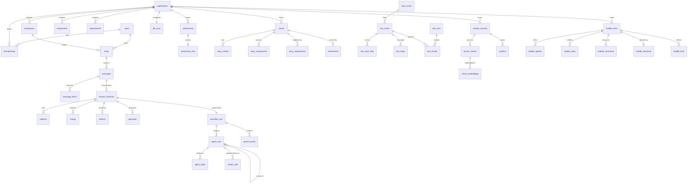

# Catalyzt data model

The persistent model behind Catalyzt. It lives in SQLite (`app/data/horizon.db` by default, see
`docs/DEPLOYMENT.md`), created by versioned migrations in `app/server/schema.ts` (17 so far). The
model is plain relational SQL with text ids; `docs/MIGRATION_NOTE.md` says what keeps a later move
to another database mechanical.

## Principles
1. **Every change has an owner and a time.** Rows that people or agents create carry `created_by` and `created_at`. Decisions (approvals, Huddle decisions) carry `decided_by` and `decided_at`.
2. **Agents are first-class actors.** Each request is a *workflow run*. Each agent the workflow spawns is an *agent run* with a parent, a task, a status and timings. Each tool call or rule check is an *agent step*. So anyone can see which agent is working on what, for whom, and why it decided what it did.
3. **Answers are revisioned, never overwritten.** A retry creates a new revision, numbered by the server inside the transaction. Ratings, citations, artifacts and approvals belong to one revision. An approval freezes the exact payload it was shown with; a newer revision supersedes older pending approvals (`expired`).
4. **What the user wrote is kept beside what was refined.** Stories store the original and the refined text.
5. **Facts are normalised where they are queried on their own.** Acceptance criteria, components, requirements, votes, test links, results and passages are tables, not JSON. Rendering detail (answer blocks, artifact bodies, approval facts) is JSON, because it is only ever read whole.
6. **Secrets are never stored.** A message rejected for containing a secret is stored without its text (`removed_reason`), never titles its chat, and never reaches a model. Guard events record the policy, not the text.
7. **Scope is explicit and enforced.** Everything that belongs to an application says so (`application_id`) or reaches it through one parent; the API refuses writes that cross a chat or application boundary and answers 404 for anything of another application.
8. **Evidence is read from a build.** UAT readiness is computed against the target build of each test's repository (its latest merge-commit run, latest attempt), never from a cached per-test last result.

## Entity map

## Tables

### People and scope
| Table | Key columns | Notes |
|---|---|---|
| `users` | `id`, `name`, `initials`, `email` | Seeded from the workspace. Behind a sign-in proxy the person is found by email; in development the browser's picker names them. |
| `applications` | `id` (ABCD), `name`, `jira_project`, `description` | The unit of scope and permissions. |
| `workspaces` | `id`, `application_id`, `name` | Repository names, in this workspace. |
| `memberships` | `user_id`, `application_id`, `role` | `member`, `app_owner`, `component_manager`, `security_champion`. Owners decide Huddle items; owners and component managers approve. |
| `components` | `id` (`<app>/<name>`), `application_id`, `name`, `manager_id`, `workspace_id`, `repo`, `path`, `language`, `tests` | Adding one to a request means regression. |
| `requirements` | `uid` (`<application>/<external id>`), `application_id`, `external_id` (FR-0231), `title`, `source_id`; unique (`application_id`, `external_id`) | A requirement number is scoped to its application (F23): FR-0231 in two applications is two records. Stories link by `uid`; test links carry the external id and are scoped through the test's application. |

### Conversations
| Table | Key columns | Notes |
|---|---|---|
| `chats` | `id`, `application_id`, `workspace_id`, `title`, `agent`, `test_type`, `created_by` | The browser chooses the id; the server refuses a chat that would change application or owner. Only the creator adds to a chat; teammates read it. |
| `messages` | `id`, `chat_id`, `seq`, `role`, `text`, `test_type`, `test_type_source`, `removed_reason` | A user message, or the slot for an answer. `removed_reason` is set when a guard refused the text before it was kept. |
| `message_items` | `message_id`, `item_type`, `item_ref` | What was attached: `story`, `component`, `file` (an attachment id), `source`. |
| `answer_revisions` | `id` (`<answer>-r<n>`), `message_id`, `revision`, `status`, `intent` (JSON), `blocks` (JSON), `workflow_run_id` | Immutable; inserted once per run with a server-allocated number. |
| `citations` | `revision_id`, `n`, `source_type`, `source_ref`, `title`, `detail` | Numbered sources. `source_type = 'link'` keeps the place the source opens (`source_ref`), e.g. an App Context passage. |
| `ratings` | `revision_id`, `user_id`, `stars`, `reasons` (JSON), `comment` | One per person per revision. Below 4 stars needs a reason and a comment. Feeds the feedback-pattern rule, never people assessment. |
| `artifacts` | `id` (`<revision>/<local id>`), `chat_id`, `revision_id`, `local_id`, `kind`, `title`, `body` (JSON) | One row per revision: a later answer never changes what an earlier approval saw. |
| `approvals` | `id` (`<revision>-a<i>`), `revision_id`, `action`, `target` (JSON), `facts` (JSON), `payload` (JSON), `status`, `decided_by`, `decided_at`, `outcome` (JSON), `executed_at`, `superseded_by` | `payload` is the exact action (for `add_uat_cases`: the story and the cases) frozen when shown. Status `pending`, `approved`, `declined`, `expired` (superseded by a newer revision). Decision and execution are one transaction; a replay returns the recorded outcome. |
| `attachments` | `id`, `application_id`, `chat_id`, `filename`, `mime`, `size`, `sha256`, `storage_key`, `status`, `note`, `text_chars`, `created_by` | Uploaded through the composer. Bytes live in the blob store under `storage_key`; `status` is `ready` (text readable), `stored` (kept, not readable in this build) or `failed`. Bound to the first chat it is used in. |
| `attachment_text` | `attachment_id`, `text` | The text read from a readable attachment, given to the model as a numbered source. |

### Agents and guardrails
| Table | Key columns | Notes |
|---|---|---|
| `workflow_runs` | `id`, `application_id`, `chat_id`, `message_id`, `revision`, `requested_by`, `status`, `summary`, `started_at`, `ended_at` | One per answer revision (and one per refinement, scan or import). Status: `running`, `done`, `failed`, `rejected`, `stopped`. A restart marks leftovers stopped. |
| `agent_runs` | `id`, `workflow_run_id`, `parent_id`, `agent`, `kind`, `task`, `status`, `model`, `prompt_tokens`, `completion_tokens`, `result`, `error` | The Orchestrator is the root; it spawns the guard, router and one sub-agent. |
| `agent_steps` | `id`, `agent_run_id`, `seq`, `kind`, `tool`, `label`, `detail`, `status` | `kind`: `rule` (no model), `model`, `tool` (Jira, Hexa, attachments, App Context). |
| `guard_events` | `id`, `workflow_run_id`, `agent_run_id`, `layer`, `policy`, `user_id` | `layer`: `input`, `router`, `output`, `story`. Never the message text. |
| `audit_log` | `id`, `at`, `actor_type`, `actor_ref`, `action`, `entity_type`, `entity_ref`, `detail` (JSON) | Approvals, decisions, story creation, filter changes, scans, imports, uploads, rejections, migration notes. Append only. |
| `model_calls` | `workflow_run_id`, `agent_run_id`, `agent`, `user_id`, `model`, `purpose`, `status`, `prompt_tokens`, `completion_tokens`, `latency_ms` | The token ledger; tokens are NULL when the provider did not report them. |

### Jira and UAT
| Table | Key columns | Notes |
|---|---|---|
| `jira_sync` | `application_id`, `project`, `statuses` (JSON), `every_minutes`, `last_sync_at` | The filter that decides which stories are pulled. |
| `stories` | `key`, `application_id`, `project`, `number`, `summary`, `description`, `type`, `status`, `fix_version`, `assignee`, `assignee_id`, `purpose`, `original` (JSON), `refinement_id`, `source`, `created_by` | `source`: `jira_sync` or `horizon` (created here, in the dummy Jira; the value is a stored identifier and stays). |
| `story_criteria`, `story_components`, `story_requirements` | | Acceptance criteria (AC1, AC2…), components, requirements (`requirement_uid`). Triggers refuse a link between a story and a component or requirement of another application; the same guard covers chat↔workspace, run↔test and test↔story/criterion/component links (migration 14). |
| `refinements` | `id`, `story_key`, `input` (JSON), `output` (JSON), `source`, `model`, `agent_run_id`, `created_by` | Every refinement is kept, used or not. |
| `uat_analyses`, `uat_criterion_results` | | Reserved for a per-analysis record; today the UAT report lives in the answer's artifact and is recomputed from Hexa on each analysis. |

### Hexa: test case inventory and evidence
| Table | Key columns | Notes |
|---|---|---|
| `test_cases` | `id`, `application_id`, `title`, `suite`, `code_name`, `kind`, `purpose`, `framework`, `origin`, `repo`, `ref`, `path`, `line`, `url`, `status`, `last_result`, `scan_id`, Octane fields (`external_id`, `description`, `test_type`, `phase`, `owner`, `designer`, …) | `kind`: `automated`, `manual`, `proposed`. A proposed UAT case has `external_id = UAT-<story>-<criterion>` and is accepted in place (becomes `manual`) when its approval executes; proposals never count as coverage. Scanned ids are hashes of (application, repository, path, suite, title). `last_result` is the test's own latest result for the list; readiness does not use it. |
| `test_case_links` | `test_case_id`, `entity_type`, `entity_ref` | What a test covers: `story`, `criterion` (`ABCD-1001#AC2`), `requirement`, `component` (`<app>/<name>`). |
| `test_steps` | `test_case_id`, `seq`, `step_type`, `description` | Manual steps as in Octane. |
| `repo_scans` | `id`, `application_id`, `repo`, `ref`, `sha` (commit), `status`, `files_found`, `files_scanned`, `files_failed`, `tests_found`, `tests_new`, `tests_removed`, `truncated`, `complete` | A scan removes a test only when its file was read and no longer holds it, or a complete listing no longer has the file. |
| `test_runs` | `id`, `application_id`, `source`, `repo`, `workflow`, `external_run_id`, `attempt`, `run_url`, `event`, `branch`, `sha`, `pr_number`, `is_merge`, `status`, totals | Unique per application, source, repository, run and attempt; a rerun is a new attempt. The **target build** of a repository is its latest merge-commit run (latest attempt), else its latest run. |
| `test_results` | `run_id`, `test_case_id`, `status`, `duration_ms`, `message` | One test's result in one run. Readiness reads a linked test's result in the target build: `passed`, `failed`, `skipped`, or `missing` from that run. |
| `hexa_uploads` | `id`, `application_id`, `kind`, `filename`, `format`, `created`, `updated`, `problems` | Every upload and what it changed. |

### Knowledge and decisions
| Table | Key columns | Notes |
|---|---|---|
| `context_sources` | `id`, `application_id`, `scope_type`, `scope_ref`, `type`, `title`, `subtitle`, `trust`, `status`, `content`, `note`, `href`, `location`, `size_bytes`, `mime`, `version`, `storage_key`, `sha256`, `synced_at`, `created_by` | `type`: `Repository` (documentation read from the clone), `Jira`, `Text` (readable upload), `PDF`, `Word`, `Image`, `ZIP`, `File`. `trust`: `High`, `Tickets`, `Code`, `Team upload`. `status`: `ready`, `indexed`, `review` (open conflict), `stored` (kept, not readable in this build), `failed`. `version` bumps when the text changes; citations carry it. No Confluence or Fabric is connected. |
| `source_chunks` | `id` (`<source>@v<version>#<seq>`; version-1 rows from before migration 15 are `<source>#<seq>`), `source_id`, `seq`, `locator`, `text`, `excluded_reason`, `source_version`, `chars`, `text_sha`, `retired_at` | Passages, kept as history (F20): a re-index retires the current version's passages and writes the new version; a citation's link `…?v=<version>#chunk-<seq>` keeps opening the text it cited. Retrieval, counts and conflicts see current passages (`retired_at IS NULL`) only. Excluded passages stay excluded until a decision; a passage that holds what looks like a secret stays excluded. |
| `source_chunks_fts` | FTS5 virtual table over `source_chunks` (`text`, `locator`; external content, porter stemming) | The lexical side of retrieval (F24): a question's candidates are the best bm25 matches, never the whole table. Triggers keep it in step; the server runs the strict integrity check at start and rebuilds when needed. |
| `chunk_embeddings` | `chunk_id`, `model`, `dims`, `vector` (float32 BLOB, unit length), `text_sha`, `created_at`; key (`chunk_id`, `model`) | One vector per passage and embedding model, written by the background embedding job (`server/retrieval.ts`). Retrieval is hybrid: keyword overlap and cosine similarity fused by rank, then reranked by a local cross-encoder; a passage without a vector still matches by keyword. Removing a passage removes its vectors; a re-index keeps vectors whose text did not change (`text_sha`). |
| `conflicts` | `id`, `source_id`, `other_source_id`, `title`, `detail`, `compare` (JSON), `huddle_item_id`, `status`, `resolution`, `created_at`, `resolved_at` | A source against a higher-trust one. Resolved by the Huddle decision (`keep_higher` or `use_upload`) in the same transaction. |
| `huddle_items` | `id`, `application_id`, `kind`, `title`, `summary`, `scope`, `ai_summary`, `citations` (JSON), `source_id`, `status`, `needs_input`, `raised_by_type`, `raised_by` | `kind`: `conflict`, `mapping`, `risk`, `feedback`. Raised by a person or by Catalyzt (the feedback-pattern rule). |
| `huddle_options` | `id`, `item_id`, `seq`, `label`, `detail`, `keeps_upload` | Ordered. For conflicts, the option that uses the upload. |
| `huddle_votes`, `huddle_comments` | | One vote per person per item; comments with author and time. |
| `huddle_decisions` | `item_id`, `option_id`, `reason`, `decided_by`, `decided_at` | Only an app owner decides; a reason is required. |
| `huddle_links` | `item_id`, `entity_type`, `entity_ref`, `label`, `href` | What a decision affects, and dedupe keys (`feedback_pattern`). |

## Agent activity: how "who is working on what" is answered
- **Running now:** `agent_runs` with `status = 'running'`, joined to `workflow_runs` (who asked, which chat) and to the parent agent run (who spawned it).
- **What it was asked:** `agent_runs.task`, written by the agent that spawned it.
- **How it got there:** `agent_steps` in order, each marked rule, model or tool.
- **Why something was refused:** `guard_events` and the failed guard's `agent_runs.result`.

## What is stored today
Everything above is read and written by the server now: people and scope; chats, messages, answer revisions, citations, artifacts, ratings and approvals; attachments; the agent and token ledgers; stories and refinements; Hexa tests, links, scans, runs and results; App Context sources, passages and conflicts; Huddle items, votes, comments and decisions. The browser keeps nothing authoritative; its stores are views of the server for the selected person and application and drop responses from an earlier selection. Only `uat_analyses` and `uat_criterion_results` are unused for now.
