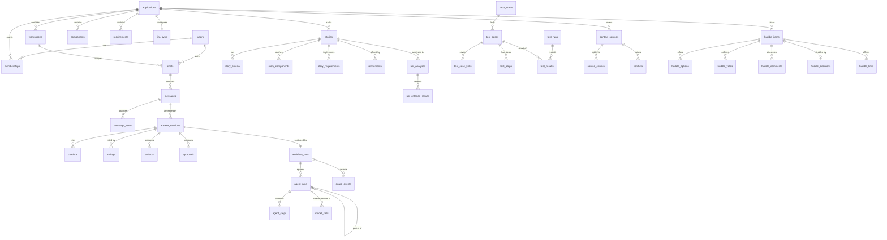

# Horizon data model

The persistent model behind Horizon. It lives in SQLite (`app/data/horizon.db`) for this preview, created by versioned migrations in `app/server/schema.ts`. The model is plain relational SQL, so it moves to Postgres without changing its shape.

## Principles
1. **Every change has an owner and a time.** Rows that people or agents create carry `created_by` and `created_at`. Decisions (approvals, Huddle decisions) carry `decided_by` and `decided_at`.
2. **Agents are first-class actors.** Each request is a *workflow run*. Each agent the workflow spawns is an *agent run* with a parent, a task, a status and timings. Each tool call or rule check is an *agent step*. So anyone can see which agent is working on what, for whom, and why it decided what it did.
3. **Answers are revisioned, never overwritten.** Retry creates a new revision; ratings, citations, artifacts and approvals belong to one revision.
4. **What the user wrote is kept beside what was refined.** Stories and feedback store the original and the refined text, and which one was used.
5. **Facts are normalised where they are queried on their own.** Acceptance criteria, components, requirements, votes and criterion results are tables, not JSON. Rendering detail (answer blocks, artifact bodies) is JSON, because it is only ever read whole.
6. **Secrets are never stored.** A message rejected for containing a secret is stored as removed. Guard events record the policy, not the text.
7. **Scope is explicit.** Everything that belongs to an application says so (`application_id`), and context sources say whether they apply to the app, a workspace or one chat.

## Entity map

## Tables

### People and scope
| Table | Key columns | Notes |
|---|---|---|
| `users` | `id`, `name`, `initials`, `email` | Identity comes from SSO in production; this preview seeds users and has no sign-in. |
| `applications` | `id` (App-abcd), `name`, `jira_project` | The unit of scope and permissions. |
| `workspaces` | `id`, `application_id`, `name` | e.g. web-ui, api. |
| `memberships` | `user_id`, `application_id`, `role` | `member`, `app_owner`, `security_champion`. App owners decide Huddle items. |
| `components` | `id`, `application_id`, `name`, `repo`, `indexed_commit` | Adding one to a request means regression. |
| `requirements` | `id` (FR-0231), `application_id`, `title`, `source_id` | From the Enterprise Knowledge Fabric. |

### Conversations
| Table | Key columns | Notes |
|---|---|---|
| `chats` | `id`, `application_id`, `workspace_id`, `title`, `agent`, `test_type`, `created_by` | `agent` is the picker value (`auto` or a capability). |
| `messages` | `id`, `chat_id`, `seq`, `role`, `text`, `test_type`, `test_type_source`, `removed_reason` | A user message, or the slot for an answer. `removed_reason` is set when a guard removed the text. |
| `message_items` | `message_id`, `item_type`, `item_ref` | What was attached: `story`, `component`, `file`, `source`. |
| `answer_revisions` | `id`, `message_id`, `revision`, `status`, `intent` (JSON), `blocks` (JSON), `workflow_run_id` | Status: `working`, `streaming`, `done`, `error`, `stopped`. |
| `citations` | `revision_id`, `n`, `source_type`, `source_ref`, `title`, `detail` | Numbered sources shown in the answer. |
| `ratings` | `revision_id`, `user_id`, `stars`, `reasons` (JSON), `comment`, `refined_comment`, `used_refined`, `selection` (JSON) | One per user per revision. Feeds evaluation, never people assessment. |
| `artifacts` | `id`, `chat_id`, `revision_id`, `kind`, `title`, `body` (JSON) | `code`, `uat_report`, `coverage_report`. Has its own URL. |
| `approvals` | `id`, `revision_id`, `action`, `target` (JSON), `facts` (JSON), `status`, `decided_by`, `decided_at` | `open_pr`, `add_uat_cases`, `gitops_change`. Approving requires a rating on the revision. |

### Agents and guardrails
| Table | Key columns | Notes |
|---|---|---|
| `workflow_runs` | `id`, `chat_id`, `message_id`, `revision`, `requested_by`, `status`, `summary`, `started_at`, `ended_at` | One per answer revision. Status: `running`, `done`, `failed`, `rejected`, `stopped`. |
| `agent_runs` | `id`, `workflow_run_id`, `parent_id`, `agent`, `kind`, `task`, `status`, `model`, `prompt_tokens`, `completion_tokens`, `result`, `error`, `started_at`, `ended_at` | The Orchestrator is the root; it spawns the guard, router and one sub-agent. `kind`: `orchestrator`, `guard`, `router`, `specialist`, `tool_agent`, `refiner`. |
| `agent_steps` | `id`, `agent_run_id`, `seq`, `kind`, `tool`, `label`, `detail`, `status`, `started_at`, `ended_at` | `kind`: `rule` (no model), `model`, `tool` (Jira, test evidence). |
| `guard_events` | `id`, `workflow_run_id`, `agent_run_id`, `layer`, `policy`, `user_id`, `created_at` | `layer`: `input`, `router`, `output`. Never the message text. |
| `audit_log` | `id`, `at`, `actor_type`, `actor_ref`, `action`, `entity_type`, `entity_ref`, `detail` (JSON) | Approvals, decisions, story creation, filter changes, scans, rejections. Append only. |
| `model_calls` | `workflow_run_id`, `agent_run_id`, `agent`, `user_id`, `model`, `purpose`, `status`, `prompt_tokens`, `completion_tokens`, `latency_ms` | The token ledger: one row per model call (`intent`, `answer`, `refine`). Tokens are NULL when the provider did not report them, so totals never count unknown as zero. |

### Jira and UAT
| Table | Key columns | Notes |
|---|---|---|
| `jira_sync` | `application_id`, `project`, `statuses` (JSON), `every_minutes`, `last_sync_at` | The filter that decides which stories Horizon pulls. |
| `stories` | `key`, `application_id`, `project`, `number`, `summary`, `description`, `type`, `status`, `fix_version`, `assignee`, `original` (JSON), `refinement_id`, `source`, `created_by` | `source`: `jira_sync` or `horizon` (created here, in the dummy Jira). `original` keeps what the author wrote. |
| `story_criteria` | `story_key`, `seq`, `text` | Acceptance criteria, AC1, AC2… |
| `story_components`, `story_requirements` | `story_key`, `component_id` / `requirement_id` | |
| `refinements` | `id`, `story_key`, `input` (JSON), `output` (JSON), `source`, `model`, `agent_run_id`, `created_by` | Every refinement is kept, used or not. |
| `uat_analyses` | `id`, `story_key`, `chat_id`, `workflow_run_id`, `state`, `covered`, `not_run`, `no_test`, `created_by` | `state`: `gaps`, `ready`. |
| `uat_criterion_results` | `analysis_id`, `seq`, `status`, `evidence` | `passing`, `not_run`, `no_test`. |

### Hexa: test case inventory
| Table | Key columns | Notes |
|---|---|---|
| `test_cases` | `id`, `application_id`, `title`, `suite`, `kind`, `framework`, `origin`, `repo`, `ref`, `path`, `line`, `url`, `status`, `last_result`, `scan_id` | `kind`: `automated`, `manual`, `proposed`. `origin`: `repo_scan`, `uat_analyst`, `authoring`, `manual`. Scanned ids are stable hashes, so a re-scan updates rather than duplicates; tests gone from the repo are marked `removed`, not deleted. |
| `test_case_links` | `test_case_id`, `entity_type`, `entity_ref` | What a test covers: `story`, `criterion` (`PAY-1482#AC2`), `requirement`, `component`. |
| `repo_scans` | `id`, `repo`, `ref`, `sha`, `status`, `files_found`, `files_scanned`, `tests_found`, `tests_new`, `tests_removed`, `workflow_run_id`, `started_by` | One per scan; the Repo scanner agent's run is linked, so scans show on the Agents page. |
| `test_steps` | `test_case_id`, `seq`, `step_type`, `description` | Manual test steps as in Octane: `simple`, `validation`, `call`. |
| `test_runs` | `id`, `source`, `repo`, `workflow`, `external_run_id`, `run_url`, `branch`, `sha`, `pr_number`, `is_merge`, `status`, `total`, `passed`, `failed`, `skipped` | One CI run or uploaded results file. `source`: `github_actions`, `webhook`, `upload`. Unique per source, repo and external run id, so a run is never ingested twice. |
| `test_results` | `run_id`, `test_case_id`, `status`, `duration_ms`, `message` | One test's result in one run; a test's `last_result` follows its newest run. |
| `hexa_uploads` | `id`, `kind`, `filename`, `format`, `created`, `updated`, `problems` | Every upload, with what it changed and the rows it could not use. |

`test_cases` also carries `purpose` (`uat`, `regression`), `code_name` (for matching CI results), and the Octane fields (`external_id`, `description`, `test_type`, `phase`, `owner`, `designer`, `product_areas`, `application_modules`, `user_tags`, `estimated_minutes`). Origins now include `upload` and `ci_results`.

### Knowledge and decisions
| Table | Key columns | Notes |
|---|---|---|
| `context_sources` | `id`, `application_id`, `scope_type`, `scope_ref`, `type`, `title`, `trust`, `status`, `stage`, `created_by` | Fabric, Confluence, Jira, repository, uploads. `scope_type`: `app`, `workspace`, `chat`. |
| `source_chunks` | `id`, `source_id`, `locator`, `text`, `excluded_reason` | Embeddings live in the vector store, keyed by chunk id. |
| `conflicts` | `id`, `source_id`, `other_source_id`, `summary`, `huddle_item_id`, `status` | |
| `huddle_items` | `id`, `application_id`, `kind`, `title`, `summary`, `status`, `needs_input`, `raised_by_type`, `raised_by` | Raised by a user or by an agent. |
| `huddle_options`, `huddle_votes`, `huddle_comments` | | One vote per user per item. |
| `huddle_decisions` | `item_id`, `option_id`, `reason`, `decided_by`, `decided_at` | Only an app owner decides. |
| `huddle_links` | `item_id`, `entity_type`, `entity_ref` | What a decision affects. |

## Agent activity: how "who is working on what" is answered
- **Running now:** `agent_runs` with `status = 'running'`, joined to `workflow_runs` (who asked, which chat) and to the parent agent run (who spawned it).
- **What it was asked:** `agent_runs.task`, written by the agent that spawned it, e.g. the Router gives the CloudOps agent "Investigate payments-api restarts".
- **How it got there:** `agent_steps` in order, each marked rule, model or tool.
- **Why something was refused:** `guard_events` and the failed guard's `agent_runs.result`.

## What is stored today
This preview implements the schema in full. These parts read and write it now:
- People and scope (seeded).
- Agents and guardrails: every request's workflow run, agent runs, steps, guard events and audit.
- The token ledger: every model call, with totals on the Agents page.
- Hexa: manual tests (Octane) with steps, automated tests from repo scans and CI, pipeline runs and per-test results, uploads, and their links.
- Jira and UAT stories: stories, criteria, components, requirements, refinements, and the sync filter.
- Chats and messages: a chat row and the user's message are recorded with each request, so agent runs link to them.

Answer revisions, ratings, artifacts, approvals, UAT results, App Context and Huddle still live in the browser's in-memory stores. Their tables are ready, and moving them is the next step. Next additions for the POC are in [POC_PLAN.md](POC_PLAN.md).
